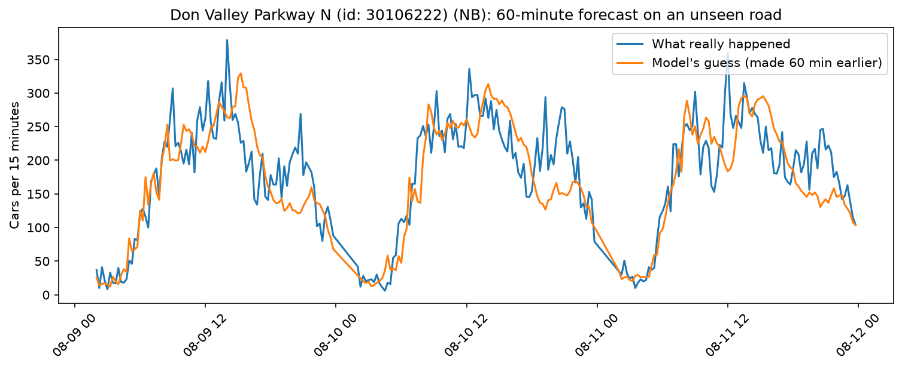

# Toronto Traffic Forecaster 🚗

Predicts how many cars will pass a spot on a Toronto road **15, 30 and 60 minutes ahead**, using real City of Toronto traffic counts.



## Data
[City of Toronto Open Data: Traffic Volumes (Midblock Vehicle Speed, Volume and Classification Counts)](https://open.toronto.ca/dataset/traffic-volumes-midblock-vehicle-speed-volume-and-classification-counts/). These are car counts in 15-minute chunks from short-term counters on streets around the city, from 2021 to 2022.

## How it works
- **Features:** time of day, day of week, weekend flag, and traffic over the last hour
- **Relative scaling:** the model predicts how much busier or quieter traffic will be *compared to the last hour*, so it works on both quiet side streets and highways like the DVP
- **Model:** gradient boosting (scikit-learn `HistGradientBoostingRegressor`), one model for each horizon
- **Baseline:** the "lazy guess", which assumes traffic stays exactly the same as right now

## Results
Tested on 6 streets the model never saw during training (including the Don Valley Parkway). The score is mean absolute error (MAE) in cars per 15 minutes, so lower is better.

| Horizon | Lazy guess | Model | Improvement |
|---|---|---|---|
| 15 min | 5.13 | 4.88 | 5% |
| 30 min | 5.99 | 5.56 | 7% |
| 60 min | 7.33 | 6.53 | 11% |

## What I learned
- My first split let streets leak between training and testing. Once I fixed it, the model did **worse than the baseline** on new streets.
- Predicting *relative* change instead of raw car counts fixed it, so the model now works on roads of any size.
- Adding 30× more data from 2015–2019 made results **worse**, likely because pre-COVID traffic patterns didn't match 2021–2022.

## Run it yourself
```bash
python3.12 -m venv venv
source venv/bin/activate
pip install pandas scikit-learn matplotlib requests jupyter
```
Then open `traffic_final.ipynb` and click **Run All**. It downloads the data automatically. (`exploration.ipynb` has my full working process, including the experiments that didn't work.)